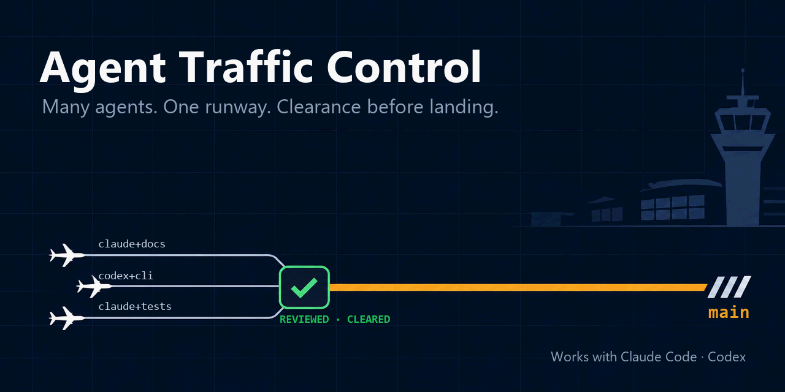

# Agent Traffic Control



[](LICENSE)
[](adapters/python/pyproject.toml)


[繁體中文](README.zh-TW.md)

**Many agents. One runway. Clearance before landing.**

Who is cleared to write, one writer per branch, and clean handoffs between
sessions. For one owner running several coding agents across several
repositories. Not a gateway, not an orchestrator.

Three guarantees, each held by an `atc` command rather than by an agent
reading the rules:

- **`main` moves only to a reviewed, verified SHA.** `atc integrate`
  fast-forwards `main` to a candidate built from the exact SHA named as
  reviewed. It refuses without a task record bound to that branch, without
  the Owner's authority (granted in the record on `main`, or quoted with
  `--owner-words`), and without a passing integration verifier run on that
  candidate (a range of task records alone gets the record check instead).
- **Every worktree says whose it is.** `atc worktree` writes owner, topic and
  session into the worktree's git lock reason. `resume` refuses a worktree
  another session holds unless it is explicitly rebound, and `clean` refuses
  one that is dirty or not merged into `main`.
- **Hard denies are harness configuration, not prose.** `atc enforce`
  generates Claude Code's `permissions.deny`, a Codex rules block and a git
  pre-commit hook from one `hard-deny.yaml`, and `--check` reports drift.
  Once installed, the harness refuses the denied action.

## Why

Running Claude Code, Codex and your own tooling against the same repositories
fails in ways no single harness fixes:

- **Two sessions write the same branch.** Each one is right about its own
  diff and wrong about the branch.
- **A session resumes from a stale SHA.** The handoff note said where things
  were; the branch has moved since.
- **"Done" in the summary, unpushed in git.** The next session trusts the
  prose instead of the repository.
- **A worktree one tool created, another tool cleans up.** Nothing recorded
  whose it was.
- **An agent pushes because it can.** Having the credential was mistaken for
  having the permission.

Each failure has one mechanism here, and every mechanism is anchored in git,
the one thing every agent and every language already has.

| Failure | Mechanism |
| --- | --- |
| Concurrent writers | One active writer per topic branch; writer transfer is explicit and grants no publication authority |
| Stale resumption | Every handoff names base SHA, target SHA and verification state; the receiver rechecks the ref before its first mutation |
| Prose outranks git | Truth order: runtime evidence, then git and files, then design records, then handoff notes, then tool memory |
| Orphan worktrees | Owner, topic and session live in the worktree's git lock reason; any tool can read who holds it |
| Capability mistaken for authority | Effective authority is the intersection of task grant, governance and project policy; hard deny, approval required and permission presets are data, generated into each harness's own config |
| Unreviewed code reaching `main` | `atc integrate` fast-forwards `main` only to the exact SHA a reviewer passed, on the Owner's word for that SHA, bound by the task record in `.atc/tasks/`, after the integration verifier passes on the candidate |

## What is here

| Path | Holds |
| --- | --- |
| `shared/governance/` | The rules every agent reads at a pinned revision: `CORE.md` plus modules routed by `INDEX.md` |
| `shared/policies/` | JSON Schemas and examples for hard deny, approval required, permission presets and the escalation gate |
| `shared/skills/` | Canonical skills shared across tools and repositories; `.claude/`, `.agents/` and `.dsh/` hold the managed copies rendered from them |
| `shared/templates/` | The pointer line onboarding inserts into a project's `AGENTS.md` and the bootloader it writes to `.atc/README.md` |
| `shared/conformance/` | Language-neutral fixtures every tool implementation must pass |
| `scripts/` | POSIX sh entry points that need no language runtime: install and check skill adapters |
| `adapters/python/` | The Python reference implementation of the tools |
| `adapters/python/atc-testkit/` | The test kit behind `atc test` and `atc tmp`, which projects vendor as a wheel |
| `.atc/tasks/` | This repository's task records |
| `docs/` | How the tools work: `WORKFLOW.md` walks one task; `LAYOUT.md`, `TASKS.md`, `TESTKIT.md`, `ENFORCEMENT.md` and `ATC_HOME.md` are the references |
| `workspace.yaml.example` | The machine-local map from project name to repository, worktree and state roots |

Contracts are files: Markdown rules, YAML policies, JSON Schemas, git
metadata. Tools are replaceable implementations of those contracts. Python is
the reference implementation, not a requirement.

## atc-testkit

atc-testkit is the pytest side of the verification contract, and the code
behind `atc test` and `atc tmp`:

- **Tests run against the tree you name.** `atc tmp checkout` exports an
  exact commit into a scratch directory; `atc test run` runs pytest against
  that copy or a worktree and keeps the output in a log. An import-location
  guard stops the run when the code under test is imported from anywhere
  else.
- **Each run gets its own settings.** The run drops the host's `HAMI_*`
  variables and points the project's data-root variables and the temporary
  directory into the scratch. It is not a sandbox: the tests still run with
  your account's file and network access.
- **Tests carry a category and run in stages.** Markers classify each test,
  stages run the parallel ones first and the serial ones after, and a
  change-impact selection picks the test files a change can affect.
- **Guards get mutated.** `atc test mutants` changes one guard at a time on
  an exported commit and reports which mutants the tests failed to catch.
- **Projects get the gate skeletons.** A project's pre-push gate and
  integration verifier are built from the testkit's skeletons, and the
  project vendors the wheel this repository builds, so its CI needs nothing
  from this checkout.

`docs/TESTKIT.md` is the reference.

## Installation

Prerequisites: git. The full workspace path also needs [uv](https://docs.astral.sh/uv/).

### Skills only, no Python

```sh
git clone https://github.com/yulinnliu/agent-traffic-control.git atc
atc/scripts/link-skills.sh path/to/your-repo     # every baseline skill
atc/scripts/link-skills.sh path/to/your-repo atc-worktree hami-writing-for-agents
```

`link-skills.sh` copies each skill into `.claude/skills/`, `.agents/skills/`
and `.dsh/skills/` as a complete managed copy, vendors the governance rules
into `.atc/governance/` with the bootloader in `.atc/README.md` and their
source and revision in `.atc/atc.lock`, adds `CLAUDE.md` when the repository
has none, and inserts the pointer line before the first section of
`AGENTS.md`. It stops before writing anything when `AGENTS.md` has no
`## Integration verification` section or Git ignores a file it would write,
because every file it writes is committed. The repository then depends on
nothing outside itself: no environment variable,
no path back to this checkout. Files the repository owns are reported and
left alone. `--link` symlinks instead of copying; `--prune` removes adapters
whose canonical skill no longer exists. On Windows run it from Git Bash.

Skills that run a tool (`atc-worktree`, `atc-review`, `atc-coordinator`,
`atc-shared-skill`) call the `atc` command, so put it on PATH once per machine:

```sh
uv tool install -e atc/adapters/python
```

### Full workspace

```sh
git clone https://github.com/yulinnliu/agent-traffic-control.git atc
uv tool install -e atc/adapters/python
cd atc
atc bootstrap init                          # workspace.yaml, projects/ worktrees/ state/
atc bootstrap add --project my-project --url <url>    # clone, register, onboard, validate
atc bootstrap status                        # doctor plus a dry onboarding check
```

`add` also takes `--skills atc-worktree,hami-writing-for-agents` to install
opt-in adapters beside the baseline ones, and accepts a checkout you already
placed at `projects/<name>` when `--url` is omitted. The layout it expects is
in `docs/LAYOUT.md`, and `docs/WORKFLOW.md` walks one task from worktree to
push with the command of each step. `atc` finds the workspace from the
nearest `workspace.yaml` above the working directory or from the checkout it
was installed from; `ATC_ROOT` is an optional override, never a requirement.

### Keeping installed files current

Project skill files and `.atc/governance/` are rendered copies, so after
this repository changes they are re-rendered, never edited:

```sh
atc/scripts/check-skills.sh path/to/your-repo                           # current / drifted / orphaned / stale
atc/scripts/link-skills.sh --prune path/to/your-repo                    # repair
atc onboard --sync --all --prune                                        # every registered project, committed on its main
```

Every rendered file carries `managed-by: agent-traffic-control`; a file
without it is project-owned and never touched.

## Commands

`atc --help` lists the commands by group and `atc <command> --help` gives the
flags. [`adapters/python/README.md` § Commands](adapters/python/README.md#commands)
lists every command with what it does and where its reference lives. Exit
codes, `--json`, naming, versions and deprecated forms:
`shared/conformance/CLI.md`.

## Skills

A skill that teaches an `atc` command is named `atc-<name>`; a skill about
agent working practice is named `hami-<name>`. Model-invoked unless marked
user-invoked.

- **atc-worktree** creates, resumes, audits and cleans up per-topic worktrees whose identity lives in git.
- **hami-handoff-reminder** decides whether to hand off, compact or write a handoff note.
- **atc-coordinator** (user-invoked) coordinates one task across a writer session and a reviewer session: opens the task, briefs both sessions, hands the Owner the integration and push commands for an exact SHA and reads their completion from Git, closes the task.
- **atc-review** runs writer/reviewer work across two sessions that cannot see each other, whatever carries the messages (a paste, a session message, a notes file): step reports, reviews, verdict blocks, the integration check.
- **hami-retro** reviews a session record and proposes improvements.
- **hami-writing-for-agents** is the reference for writing skills, `AGENTS.md` and pointers.
- **atc-shared-skill** creates a shared skill and its rendered per-tool copies.
- **hami-token-audit** audits a repository for recurring context cost.
- **hami-token-hygiene** keeps a session cheap when delegating noisy work.
- **hami-offload-to-chatgpt** (user-invoked) prepares a self-contained research prompt for a web model.

## Scope

`SCOPE.md` says what belongs here and which issues are accepted.
`.out-of-scope/` records concepts that were tried or considered and rejected,
with the evidence. `GLOSSARY.md` defines the terms the rules use.

## Status

Version 0.4.0, the version the Python adapter carries. Governance, policies, schemas, skills, conformance fixtures and
the Python reference implementation are in place. The `validate.yml` GitHub
Actions workflow runs only when dispatched by hand: it checks the policy
examples against their schemas and runs the shell installer and the full
Python suite on Linux and Windows.

## License

MIT.
