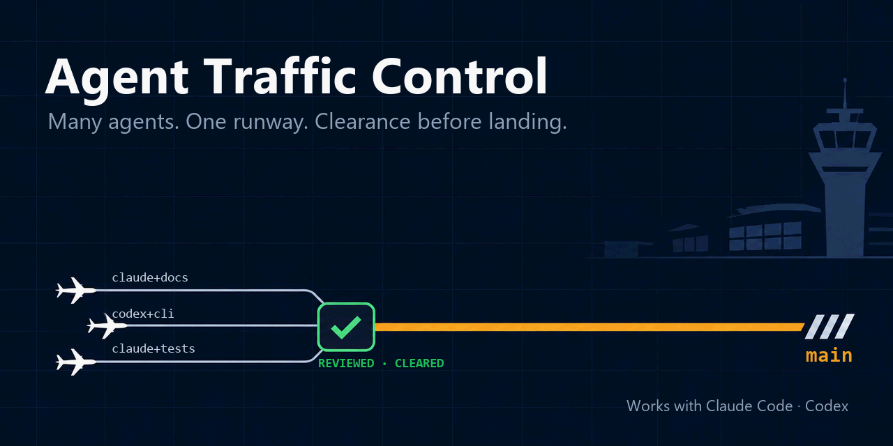

# Agent Traffic Control



[](https://github.com/yulinnliu/agent-traffic-control/releases/latest)
[](LICENSE)
[](adapters/python/pyproject.toml)


[English](README.md)

**多個 agent，一條跑道，放行才能降落。**

一個人同時讓好幾個 coding agent 在好幾個 repository 裡工作時，總得有人管：
誰可以寫、每條 branch 同時只能有一個 writer、session 之間怎麼交接才不會出錯。
Agent Traffic Control 就是做這件事的。它不是 gateway，也不是 orchestrator。

下面三項保證由 `atc` 指令本身把關，不靠 agent 讀了規則自己遵守：

- **`main` 只會移到審過、驗過的 SHA。** `atc integrate` 把 `main`
  fast-forward 到一個 candidate，這個 candidate 由指定為已審查的那個確切 SHA
  建出來。沒有綁定這條 branch 的任務紀錄、沒有 Owner 的授權（Owner 自己執行這個指令，
  並隨整合一起記錄），或 integration verifier 沒有在這個
  candidate 上通過（只改任務紀錄的範圍改跑紀錄檢查），它都會拒絕。
- **每個 worktree 都寫明是誰的。** `atc task create` 把 harness 和 task ID
  寫進 worktree 的 git lock reason。別的 session 持有的 worktree，`atc task resume`
  會拒絕，除非明確重新綁定；有未提交變更、或還沒合進 `main` 的 worktree，
  `atc task close` 會拒絕。
- **hard deny 是 harness 的設定，不是文字。** maintainer 的產生器（`atc-maintain guard`）從同一份
  `hard-deny.yaml` 產生 Claude Code 的 `permissions.deny`、Codex 的 rules 區塊
  和 git pre-commit hook，`--check` 會回報不一致；`atc guard --install` 負責裝上 hook 表。
  裝上之後，被禁止的動作由 harness 直接拒絕。

## 為什麼需要它

當 Claude Code、Codex 和你自己寫的工具都在動同一批 repository，下面這些問題
不是換一個 harness 就能解決的：

- **兩個 session 寫同一條 branch。** 各自看自己的 diff 都沒錯，合在一起就壞了。
- **session 從舊的 SHA 接著做。** 交接筆記寫的是當時的狀態，branch 早就往前走了。
- **摘要寫「完成」，git 裡卻沒 push。** 下一個 session 信了摘要，沒有去看 repository。
- **A 工具開的 worktree，被 B 工具清掉。** 沒有任何地方記著它是誰的。
- **agent 因為能 push 就 push 了。** 手上有憑證，不代表有權限。

每個問題在這裡都有一個對應的機制，而且每個機制都建立在 git 上，因為不管哪種
agent、哪種語言，git 都已經在那裡了。

| 問題 | 機制 |
| --- | --- |
| 多個 writer 同時寫 | 每條 topic branch 同時只有一個 active writer；轉交 writer 要明確交接，而且轉交不附帶發布權限 |
| 從舊狀態接手 | 每次交接都寫明 base SHA、target SHA 和驗證狀態；接手的一方在第一次修改前先重新核對 ref |
| 文字蓋過 git | 依可信度排序：runtime 證據、git 與檔案、設計紀錄、交接筆記，最後才是工具自己的記憶 |
| 沒人認領的 worktree | harness 和 task ID 寫在 worktree 的 git lock reason 裡，任何工具都讀得到是誰的 |
| 有能力就以為有權限 | 實際權限是任務授權、governance、專案 policy 三者的交集；hard deny、approval required、permission preset 都寫成資料，再產生成各 harness 自己的設定 |
| 沒審過的程式碼進到 `main` | `atc integrate` 只會把 `main` fast-forward 到 reviewer 通過的那個確切 SHA；要有 Owner 針對這個 SHA 的同意、要有 `.atc/tasks/` 裡的任務紀錄，integration verifier 在 candidate 上也要通過 |

## 裡面有什麼

| 路徑 | 內容 |
| --- | --- |
| `shared/governance/` | 每個 agent 都依固定 revision 讀取的規則：`CORE.md`，加上 `INDEX.md` 依情況導向的各模組 |
| `shared/policies/` | hard deny、approval required、permission preset、escalation gate 的 JSON Schema 和範例 |
| `shared/skills/` | 跨 harness、跨 repository 共用的 skill 正本；`.claude/`、`.agents/`、`.dsh/` 裡的是從正本 render 出來的受管副本 |
| `shared/templates/` | sync 放進專案 `AGENTS.md` 的那行指標，以及寫進 `.atc/README.md` 的 bootloader |
| `shared/conformance/` | 與語言無關的 fixture，每一種工具實作都要通過 |
| `scripts/` | 不需要任何語言 runtime 的 POSIX sh 腳本：安裝與檢查 skill adapter |
| `adapters/python/` | 這些工具的 Python 參考實作 |
| `adapters/python/atc-testkit/` | `atc test` 背後的測試工具組，專案以 wheel 的形式 vendor 進去 |
| `.atc/tasks/` | 這個 repository 自己的任務紀錄 |
| `docs/` | 工具怎麼運作：`WORKFLOW.md` 從頭到尾走一遍任務流程；`LAYOUT.md`、`TASKS.md`、`TESTKIT.md`、`ENFORCEMENT.md`、`ATC_HOME.md` 是參考文件 |
| `workspace.yaml.example` | 只存在本機的對照表，記錄每個專案的 repository、worktree 和 state 各在哪裡 |

規則本身都是檔案：Markdown 寫的規則、YAML 寫的 policy、JSON Schema，再加上
git metadata。工具只是照著這些規則做事的實作，隨時可以換掉。Python 版是參考
實作，不是一定要用 Python。

## atc-testkit

atc-testkit 負責驗證規則裡和 pytest 有關的部分，也是 `atc test`
背後的程式：

- **測試跑在你指定的 tree 上。** `atc test ID --sha SHA` 把確切的 commit 匯出到
  scratch 目錄並對這份副本跑 pytest；`atc test ID` 在任務的 worktree 裡跑。輸出存成
  log。受測程式碼如果是從別的地方 import 進來的，import 位置檢查會讓這次執行
  停下來。
- **每次執行有自己的設定。** 執行時會拿掉主機上的 `HAMI_*` 變數，把專案的
  data-root 變數和暫存目錄指到 scratch 裡。它不是 sandbox：測試仍然用你帳號的
  檔案與網路權限在跑。
- **測試有分類，分階段執行。** 每個測試用 marker 標分類，先跑可平行的階段、
  再跑必須依序的階段；change-impact selection 會挑出一個變更可能影響的測試檔。
- **guard 會被做 mutation。** `atc test ID --mutants FILE` 在匯出的 commit 上一次改一個
  guard，回報哪些 mutant 沒被測試抓到。
- **專案拿到 gate 的骨架。** 專案的 pre-push gate 和 integration verifier
  從 testkit 的骨架建起來；專案 vendor 的是這個 repository 建出來的 wheel，
  所以專案的 CI 完全不需要這份 checkout。

詳細說明在 `docs/TESTKIT.md`。

## 安裝

需要 git。要裝完整 workspace 的話，另外需要 [uv](https://docs.astral.sh/uv/)。

### 只裝 skill，不用 Python

```sh
git clone https://github.com/yulinnliu/agent-traffic-control.git atc
atc/scripts/link-skills.sh path/to/your-repo     # 所有 baseline skill
atc/scripts/link-skills.sh path/to/your-repo atc-worktree hami-writing-for-agents
```

`link-skills.sh` 會做這幾件事：

- 把每個 skill 完整複製一份到 `.claude/skills/`、`.agents/skills/`、`.dsh/skills/`，成為受管副本。
- 把 governance 規則 vendor 進 `.atc/governance/`，bootloader 寫在 `.atc/README.md`，來源和 revision 記在 `.atc/atc.lock`。
- repository 還沒有 `CLAUDE.md` 的話，幫它加上。
- 在 `AGENTS.md` 的第一個章節之前插入指標行。

因為它寫出來的每個檔案都要 commit，所以只要 `AGENTS.md` 沒有
`## Integration verification` 章節，或是 Git 會忽略它要寫的某個檔案，它就會在
寫入任何東西之前停下來。裝好之後，repository 不再依賴外部任何東西：不需要
環境變數，也沒有指回這份 checkout 的路徑。屬於 repository 自己的檔案，它只會
回報，不會去動。加 `--link` 改用 symlink；加 `--prune` 會移除正本已經不存在的
adapter。Windows 上請用 Git Bash 執行。

`atc-worktree`、`atc-review`、`atc-coordinator`、`atc-shared-skill` 這幾個
skill 會呼叫 `atc` 指令，所以每台機器要先裝一次，讓它在 PATH 上：

```sh
uv tool install -e atc/adapters/python
```

這會安裝 distribution `agent-traffic-control`，指令名稱是 `atc`。機器上如果
已經用舊名稱 `atc-python-adapter` 裝過 `atc`，要先跑
`uv tool uninstall atc-python-adapter`（見 `adapters/python/README.md`）。

### 完整 workspace

```sh
git clone https://github.com/yulinnliu/agent-traffic-control.git atc
uv tool install -e atc/adapters/python
cd atc
atc init                                    # 建立 workspace.yaml 和 projects/ worktrees/ state/
atc add my-project --url <url>              # clone、登記、建立 ATC 檔案、驗證
atc doctor                                  # 主機與 workspace 檢查
```

`add` 可以再加 `--skills atc-worktree,hami-writing-for-agents`，在 baseline
之外多裝幾個選用的 adapter；如果你已經把 checkout 放在 `projects/<name>`，
省略 `--url` 就會直接用它。目錄要怎麼擺，寫在 `docs/LAYOUT.md`；一個任務從
開 worktree 到 push，每一步跑什麼指令，`docs/WORKFLOW.md` 都有寫。`atc` 會從
目前目錄往上找最近的 `workspace.yaml`，找不到就用當初安裝它的那份 checkout；
`ATC_ROOT` 可以拿來覆蓋，但不是必要的。

### 讓已安裝的檔案保持最新

專案裡的 skill 檔和 `.atc/governance/` 都是 render 出來的副本。這個
repository 更新之後，要做的是重新 render，而不是手動去改：

```sh
atc/scripts/check-skills.sh path/to/your-repo                           # current / drifted / orphaned / stale
atc/scripts/link-skills.sh --prune path/to/your-repo                    # 修復
atc sync                                                               # 所有已登記的專案，各自在 main 上 commit（最新 release）
atc sync my-project --check                                            # 只看一個專案，不寫入
atc sync --revision <sha>                                              # 最新 release 以外，改用 Owner 指定的 SHA
```

render 出來的檔案都帶有 `managed-by: agent-traffic-control` 標記；沒有這個
標記的檔案就是專案自己的，工具永遠不會碰。`atc sync` 也會刪掉正本已經不存在的
受管副本。`workspace.yaml` 的 `skill_harnesses` 決定每個專案要在 `.claude/`、
`.agents/`、`.dsh/` 哪幾個目錄放副本（見 `docs/LAYOUT.md`）。

## 指令

`atc --help` 列出所有指令，每個指令的參數用 `atc <command> --help` 查。
[`adapters/python/README.md` § Commands](adapters/python/README.md#commands)
列出每個指令的用途和參考文件。Exit code、`--json`、輸出與命名見
`shared/conformance/CLI.md`。

## Skills

教你用某個 `atc` 指令的 skill 叫 `atc-<name>`；講 agent 工作習慣的 skill 叫
`hami-<name>`。沒有特別標註的，都由模型自己判斷何時使用；標註 user-invoked 的
要由使用者叫用。

- **atc-worktree**：建立、接續、檢查、清理每個 topic 的 worktree，它屬於誰記在 git 裡。
- **hami-handoff-reminder**：判斷現在該交接、壓縮 context，還是寫交接筆記。
- **atc-coordinator**（user-invoked）：協調一個任務的 writer session 和 reviewer session，包括開任務、替兩邊寫 brief、針對確切的 SHA 交給 Owner 執行整合與 push 的命令、從 Git 讀取完成狀態，以及結案。
- **atc-review**：兩個互相看不到的 session 之間的 writer／reviewer 流程，不管訊息是貼上的、用 session 訊息傳的，還是寫在筆記檔裡。涵蓋步驟回報、review、verdict 區塊和整合檢查。
- **hami-retro**：回顧一段 session 紀錄，提出可以改進的地方。
- **hami-writing-for-agents**：寫 skill、`AGENTS.md` 和指標時的參考。
- **atc-shared-skill**：建立共用 skill，以及它 render 給各工具的副本。
- **hami-token-audit**：找出 repository 裡每次都要付的 context 成本。
- **hami-token-hygiene**：把會產生大量輸出的工作委派出去時，讓 session 的 token 用量壓低。
- **hami-offload-to-chatgpt**（user-invoked）：把研究題目整理成一份可以獨立使用的 prompt，交給網頁版模型。

## 範圍

`SCOPE.md` 說明哪些東西屬於這個 repository、接受哪些 issue。`.out-of-scope/`
記錄試過或考慮過、最後沒採用的做法，附上當時的證據。`GLOSSARY.md` 是規則裡
用到的術語定義。

## 狀態

目前版本是 0.5.0，也就是 Python adapter 的版號。
governance、policy、schema、skill、conformance fixture 和 Python 參考實作都
已經到位。GitHub Actions 的 `validate.yml` 在手動觸發或 Owner 推送 release
tag 時執行：它會用 schema 檢查 policy 範例，並在 Linux 和 Windows 上跑 shell
安裝腳本與完整的 Python 測試；遇到 release tag 時，接著用
`docs/releases/<tag>.md` 的內容建立 GitHub Release 草稿。

## 授權

MIT。
